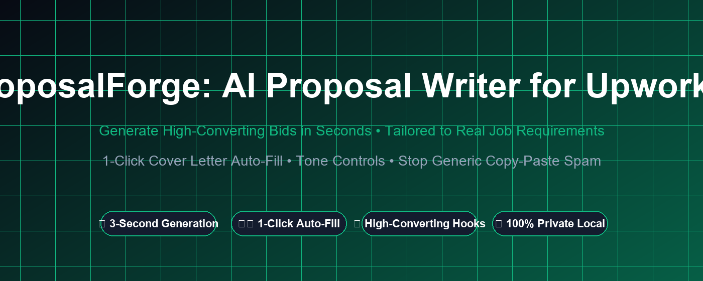
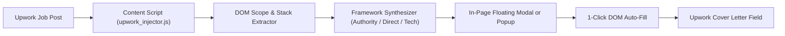

# ⚡ ProposalForge AI: High-Converting Upwork Proposal Writer

[](https://opensource.org/licenses/MIT)
[](https://chromewebstore.google.com/detail/hjikpbhnifangimjhbiogkeogolobfjd)
[](https://developer.chrome.com/docs/extensions/mv3/intro/)
[](https://aleemice.gumroad.com/l/proposalforge-ai)
[](https://whop.com/aleemice/proposalforge-pro)
[](#privacy--security)

> **Generate tailored, high-converting Upwork proposals in 3 seconds. Ingests live job scope, stacks, and budgets right from your browser view. 1-click auto-fill into Upwork's cover letter editor. $0 API latency, 100% private.**



---

## 🎯 The Problem: Why Freelancers Lose Deals on Upwork

1. **The 10-Minute Velocity Window:** Within 15 minutes of a project posting, clients often receive 30–50+ bids. Bids submitted late get buried on page 2 or ignored entirely.
2. **Generic Copy-Paste Spam Gets Filtered:** Clients can spot ChatGPT templates instantly (*"Dear Hiring Manager, I am thrilled to express my excitement..."*). Upwork clients immediately reject fluff and scan only for freelancers who understand their exact technical pain.
3. **Manual Tailoring Takes Too Long:** Reading every detail and drafting a customized 3-paragraph hook from scratch takes 12–15 minutes per bid. In a competitive market, submitting 5 bids eats 1.5 hours of unbillable time.

---

## 🚀 The Solution: ProposalForge AI

**ProposalForge AI** is a lightweight, high-performance **Manifest V3 browser extension** designed for top-rated freelancers, agencies, and independent contractors on Upwork.

- ⚡ **Instant In-DOM Job Extraction:** Automatically detects the active Upwork project: job title, technical scope, budget tier, client location, total spend, and required skills.
- 🎯 **3 High-Converting Proposal Frameworks:**
  - **🏆 Authority Hook:** Position yourself as a senior consultant who understands ROI, clean code, and zero hand-holding.
  - **⚡ Direct & Fast:** Crisp, bulleted 3-step action roadmap ideal for tight turnaround gigs and urgent fixes.
  - **💻 Technical & Scalable:** Deep technical breakdown highlighting architecture, clean commits, and modular engineering.
- ✍️ **1-Click Cover Letter Auto-Fill:** One click on *"Auto-Fill Cover Letter"* injects the tailored proposal directly into the Upwork proposal form textarea. Zero switching tabs, zero manual copy-pasting.
- ⚙️ **Persistent Freelancer Persona:** Save your name, custom title, years of experience, and proof-of-work/GitHub portfolio once—all generated bids automatically weave in your credentials.
- 🔒 **100% Client-Side & Zero Latency:** Runs entirely in your browser memory. No external server round-trips, no third-party API key fees, and zero exposure of your job feed or bidding data.

---

## 📊 Feature Comparison

| Feature | **ProposalForge AI** | **Generic ChatGPT Tab** | **Upwork Built-In AI** | **Manual Typing** |
| :--- | :---: | :---: | :---: | :---: |
| **Generation Speed** | **⚡ 3 Seconds** | 1–2 minutes | 30–45 seconds | 10–15 minutes |
| **In-Page Upwork Integration** | **✅ Floating Pill & Modal** | ❌ Separate tab | ⚠️ Limited | ❌ None |
| **1-Click Auto-Fill** | **✅ Direct DOM Fill** | ❌ Manual copy/paste | ⚠️ Partial | ❌ Manual typing |
| **Spam-Busting Hooks** | **✅ Authority / Problem-First** | ❌ Generic greetings | ❌ Cliché formatting | Dependent on mood |
| **Job Scope Auto-Detection** | **✅ Title, Budget, Stack** | ❌ Manual prompt copying | ⚠️ Generic | ❌ Manual reading |
| **API Costs / Subscriptions** | **$0 / $4.99 early-bird** | $20/mo OpenAI sub | Upwork Connects penalty | Free (Time wasted) |
| **Privacy & Security** | **🔒 100% Local / In-Browser** | Cloud server logs | Upwork tracked | Personal |

---

## 🛠️ Architecture



---

## 📦 Installation Guide

### Option 1: Chrome Web Store (1-Click Install — Recommended)
Install directly from the official store:  
👉 **[Add to Chrome (Official Store)](https://chromewebstore.google.com/detail/hjikpbhnifangimjhbiogkeogolobfjd)**

---

### Option 2: Chrome / Edge Developer Mode (Manual Unpacked)
1. Clone or download this repository:
   ```bash
   git clone https://github.com/AleemBajwa/proposalforge-ai.git
   ```
2. Open Google Chrome or Microsoft Edge and navigate to:
   - Chrome: `chrome://extensions`
   - Edge: `edge://extensions`
3. Toggle on **Developer Mode** (top-right switch).
4. Click **Load unpacked** and select the `proposalforge-ai` project directory.
5. Navigate to any [Upwork Job Posting](https://www.upwork.com) and click the **⚡ ProposalForge AI** floating pill or extension icon!

---

## 💻 Tech Stack & Standards

- **Platform:** Manifest V3 (Google Chrome & Microsoft Edge compatible)
- **Permissions:** `activeTab`, `storage`, `scripting`, `https://*.upwork.com/*`
- **Zero Dependencies:** Pure vanilla modern ES6+ JavaScript and CSS, zero bloated node modules.
- **Audited Security:** CSP compliant, 0 `eval()`, zero inline remote script execution.

---

## 📄 License & Publisher

Developed and published by **Aleemice Studio**.  
Licensed under the [MIT License](LICENSE).
